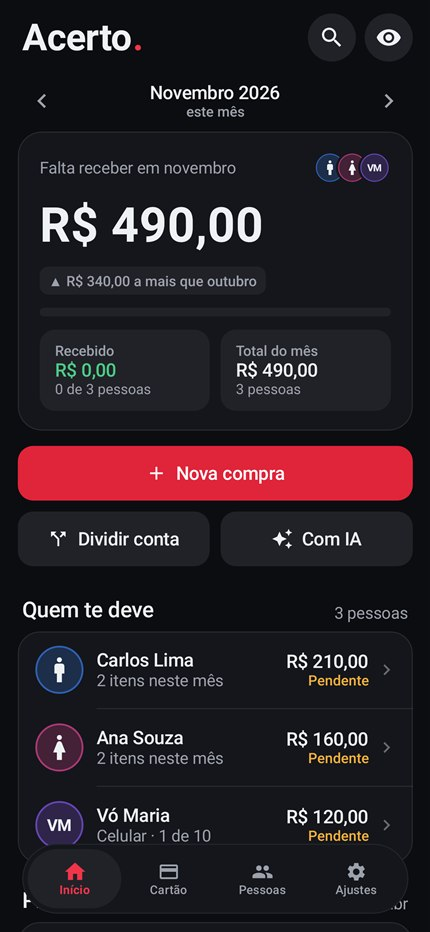
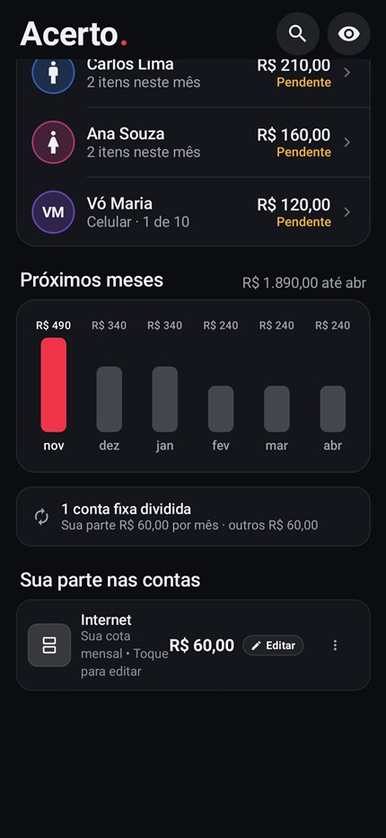
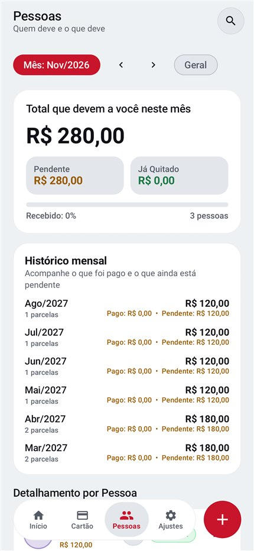

<div align="center">


# Acerto

**Controle quem te deve, sem planilha e sem constrangimento.**

Compras parceladas no seu cartão para outras pessoas, contas divididas e cobranças prontas com PIX, tudo num app Android leve, rápido e offline.

<br/>

<a href="https://github.com/carlos-gds/acerto/releases/latest">
  
</a>

<br/><br/>


</div>

---

## 📱 Telas

<div align="center">
<table>
  <tr>
    <td align="center"><br/><sub><b>Início</b> · quanto falta receber</sub></td>
    <td align="center"><br/><sub><b>Início</b> · tema claro</sub></td>
    <td align="center"><br/><sub><b>Próximos meses</b> · previsão e contas fixas</sub></td>
  </tr>
  <tr>
    <td align="center"><br/><sub><b>Pessoa</b> · marcar pago, cobrar, quando quita</sub></td>
    <td align="center"><br/><sub><b>Pessoas</b> · mês ou geral</sub></td>
    <td align="center"><br/><sub><b>Ajustes</b> · bloqueio, lembrete, PIX</sub></td>
  </tr>
</table>

<br/>
<sub><b>Cobrança</b> · imagem enviada junto com a mensagem (dados de exemplo)</sub>
</div>

---

## ✨ O que o Acerto faz

| | Recurso | Como funciona |
|:-:|---|---|
| 💳 | **Compras no cartão** | Registre a compra parcelada feita para alguém e acompanhe parcela por parcela. |
| 🧾 | **Contas divididas** | Água, luz, internet, aluguel, assinaturas: em partes iguais ou valores personalizados. |
| 🗓️ | **Mês inteligente** | Abre no mês mais antigo com pendência e só avança quando ele estiver todo pago. Atalho *Ir para o mês atual* quando outro mês está aberto. |
| 📈 | **Próximos meses** | Gráfico de quanto falta receber nos próximos 6 meses e, em cada pessoa, quanto falta no total e quando ela quita. |
| 💸 | **Cobrança com PIX** | Envia pelo WhatsApp uma **imagem** com as parcelas e o total, e uma mensagem curta com seu nome, banco e chave PIX. O tipo da chave (CPF, celular, e-mail, CNPJ ou aleatória) é detectado sozinho. |
| ➗ | **Pagamento parcial** | A pessoa pagou só uma parte? Registre o valor e o restante continua pendente. |
| ↩️ | **Desfazer exclusão** | Apagou sem querer? Toque em *Desfazer* no aviso. |
| 🔔 | **Lembrete** | No dia 1, ou 3 dias antes do vencimento da fatura, uma notificação mostra quanto falta receber. |
| 🔁 | **Contas fixas** | Resumo das contas recorrentes divididas: quantas são e a sua parte por mês. |
| 👥 | **Pessoas com avatar** | Cor da paleta, telefone formatado e avatar neutro, masculino ou feminino. |
| ⚡ | **Entrada rápida com IA** | Escreva *"Tênis de 300 em 3x para o Lucas"* e confirme. |
| 🔍 | **Pesquisa e filtros** | Por pessoa ou compra, com filtros de pendentes e quitadas. |
| 🔐 | **Bloqueio do app** | Digital, rosto ou a senha do celular ao abrir. |
| 🙈 | **Modo privacidade** | Esconde os valores, continua ligado ao reabrir e pede confirmação antes de compartilhar. |
| 💾 | **Backup em JSON** | Exporte e restaure quando quiser, inclusive backups antigos. |
| 🌗 | **Tema claro e escuro** | O escuro tem fundo quase preto, ótimo em telas AMOLED. |

---

## 🎨 Interface

<table>
<tr>
<td width="50%" valign="top">

### 🎯 Uma pergunta por tela

A Início responde **"quanto falta receber este mês, e de quem?"**. O maior bloco é esse número, com quem deve, a comparação com o mês anterior e os números de recebido e total. Logo abaixo vêm as ações, uma linha por pessoa e a previsão dos próximos meses.

Segue o **Apple HIG** (texto de 34/17/15/13, toque mínimo de 44 pt, fonte grande do sistema respeitada) e os princípios do **Taste Skill**: superfícies sólidas, sem vidro, sombra ou degradê.

</td>
<td width="50%" valign="top">

### 🎨 Cores com significado

| Cor | Uso |
|---|---|
| ⬛ **Noite** `#0C0D10` | Fundo do tema escuro |
| ⬛ **Obsidian** `#111217` | Texto do tema claro |
| ⬜ **Ice** `#EEF1F4` | Fundo do tema claro |
| 🟥 **Vermelho** `#C8152B` | Só marca: Nova compra, aba ativa, mês aberto no gráfico |
| 🟧 **Âmbar** | Pendente |
| 🟩 **Verde** | Pago |

Pessoas usam uma paleta fixa (azul, verde, turquesa, violeta, rosa, laranja, índigo, ciano), sem vermelho nem âmbar para nada parecer alerta.

</td>
</tr>
</table>

### 🎬 Movimento

Transições inspiradas no [transitions.dev](https://transitions.dev): sair em 150 ms, entrar em 250 ms, curva *smooth-out* e deslocamentos curtos.

- ↔️ Início e pessoa lado a lado
- 🔢 Total que gira só nos dígitos que mudam
- ✅ Check de sucesso ao marcar como pago
- 📊 Colunas do gráfico que crescem em sequência
- 🔤 Troca suave de mês e de status
- ♿ Movimento reduzido do sistema respeitado

---

## 🚀 Instalação

1. Abra a página de [**Releases**](https://github.com/carlos-gds/acerto/releases/latest) e baixe o arquivo `Acerto-vX.Y.apk` mais recente (cerca de 3 MB).
2. Abra o arquivo no celular e permita *instalar apps de fontes desconhecidas*, se o Android pedir.
3. Pronto: requer **Android 7.0** ou superior. Novas versões instalam por cima e mantêm seus dados.

> [!NOTE]
> As versões publicadas são otimizadas (R8) e assinadas com a mesma chave, por isso uma atualiza a outra. Se um dia a assinatura mudar, faça um backup pelo app antes de desinstalar.

---

## 🛠️ Para desenvolvedores

<details>
<summary><b>Tecnologias</b></summary>

<br/>

- **Kotlin** + **Jetpack Compose** + **Material 3**
- **Room** com migrations versionadas e esquema exportado em `app/schemas`
- **Coroutines** e **Flow**, **MVVM** com Repository pattern
- **Release otimizada:** R8, recursos enxutos e baseline profiles das bibliotecas
- Recursos nativos, sem bibliotecas extras: notificações e `AlarmManager` (lembrete), `BiometricPrompt` (bloqueio), `FileProvider` (imagem de cobrança) e Canvas (desenho da imagem)
- **Gemini API** (via OkHttp) para a entrada rápida, opcional
- **Gradle Wrapper** e Version Catalog
- **JUnit**, **Robolectric**, **Compose UI Test** e **Roborazzi**

</details>

<details>
<summary><b>Estrutura do projeto</b></summary>

```text
app/src/main/java/com/example/
├── data/
│   ├── backup/       # Modelos, serialização, validação e restauração
│   ├── db/           # Room Database, DAOs e migrations
│   ├── model/        # Entidades e modelos de domínio
│   ├── repository/   # Regras de acesso e operações financeiras
│   └── service/      # Integrações externas (Gemini)
├── ui/
│   ├── components/   # Cards, diálogos, barra inferior, controles, avatares
│   │   └── glass/    # Superfícies, movimento e transições
│   ├── screens/      # Início, pessoa, Pessoas, Ajustes e bloqueio
│   ├── theme/        # Cores, tokens, tipografia e medidas
│   └── viewmodel/    # Estado da interface e ações
└── util/             # Dinheiro, PIX, previsão, lembrete, imagem de cobrança, bloqueio
```

Os valores ficam no banco em **centavos (`Long`)**. A conversão para reais acontece só na tela, o que evita erros de arredondamento. O pagamento parcial divide a parcela em duas linhas (parte paga e restante), sem mudar o esquema do banco.

| Versão do banco | Mudança |
|:-:|---|
| 1 | Esquema inicial (valores em `REAL`) |
| 2 | Valores convertidos para centavos (`INTEGER`) |
| 3 | Coluna `avatar` em `people` (padrão `NEUTRAL`) |

</details>

<details>
<summary><b>Compilar e testar</b></summary>

<br/>

Pré-requisitos: Android Studio Ladybug ou posterior, JDK 17+ (o do Android Studio serve) e Android SDK com API 36.

```bash
./gradlew :app:assembleRelease
./gradlew :app:testDebugUnitTest
```

O APK otimizado sai em `app/build/outputs/apk/release/`. No Windows, use `gradlew.bat` no lugar de `./gradlew`.

A release usa a chave de upload apontada por `KEYSTORE_PATH` (ou `my-upload-key.jks` na raiz) quando ela existe; sem ela, assina com a chave de debug da máquina.

</details>

<details>
<summary><b>Chave da API Gemini (opcional)</b></summary>

<br/>

Sem chave, a entrada rápida usa um leitor local, mais simples. Para usar a IA:

1. Copie `.env.example` para `.env`.
2. Preencha `GEMINI_API_KEY=sua_chave_aqui`.

O `.env` está no `.gitignore`. A chave é enviada no cabeçalho `x-goog-api-key`, nunca na URL.

> [!WARNING]
> A chave fica embutida no APK. Use uma chave restrita ao app no Google Cloud ou migre para o Firebase AI Logic antes de distribuir publicamente.

</details>

---

## 🔒 Privacidade

- 📵 Sem login, sem nuvem: **todos os dados ficam no seu aparelho**.
- 🔐 Bloqueio opcional com a digital, o rosto ou a senha do celular.
- 🙈 Modo privacidade para usar o app em público.
- 💳 Chave PIX, nome e banco ficam só no aparelho, fora do backup.
- 🗂️ Backups são arquivos JSON que só você controla.
- 🧱 Gravações de vários passos rodam em transação (tudo ou nada).

---

## 🗺️ Próximos passos

- [x] ↩️ Desfazer exclusão de lançamentos
- [x] 🔔 Lembrete mensal e antes do vencimento da fatura
- [x] 🖼️ Cobrança como imagem, com nome, banco e tipo da chave PIX
- [x] 📈 Previsão dos próximos meses e data de quitação por pessoa
- [x] ➗ Pagamento parcial de parcelas
- [x] 🔐 Bloqueio do app com biometria ou senha
- [x] ♿ Layout que se adapta à fonte grande do sistema
- [x] 🚀 Versão otimizada (APK de 3 MB, bem mais fluido)
- [ ] 🎨 Cartão, Pessoas e Ajustes no mesmo estilo da Início
- [ ] 🤖 Entrada com IA via Firebase AI (sem chave no APK)
- [ ] 🔑 Chave de assinatura própria para distribuição

---

<div align="center">

<sub>Antigo <b>Quem Me Deve</b> · backups com o nome antigo continuam funcionando</sub>

<sub>Licença ainda não definida: até lá, todos os direitos reservados.</sub>

</div>
