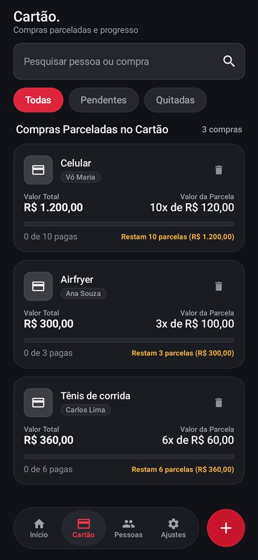
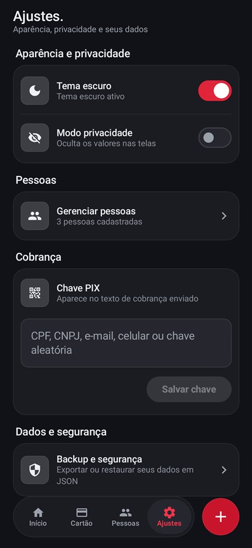

<div align="center">


# Acerto

**Controle quem te deve, sem planilha e sem constrangimento.**

Compras parceladas no seu cartão para outras pessoas, contas divididas e cobranças prontas com PIX, tudo num app Android leve e bonito.

<br/>

<a href="https://github.com/carlos-gds/acerto/releases/latest">
  
</a>

<br/><br/>


</div>

---

## 📱 Telas

<div align="center">
<table>
  <tr>
    <td align="center"><br/><sub><b>Início</b> · quanto falta receber</sub></td>
    <td align="center"><br/><sub><b>Início</b> · tema escuro</sub></td>
    <td align="center"><br/><sub><b>Pessoa</b> · marcar pago e cobrar</sub></td>
  </tr>
  <tr>
    <td align="center"><br/><sub><b>Cartão</b> · compras parceladas</sub></td>
    <td align="center"><br/><sub><b>Pessoas</b> · histórico e detalhes</sub></td>
    <td align="center"><br/><sub><b>Ajustes</b> · tema, privacidade, PIX</sub></td>
  </tr>
</table>
</div>

---

## ✨ O que o Acerto faz

| | Recurso | Como funciona |
|:-:|---|---|
| 💳 | **Compras no cartão** | Registre a compra parcelada feita para alguém e acompanhe parcela por parcela. |
| 🧾 | **Contas divididas** | Água, luz, internet, aluguel, assinaturas: em partes iguais ou valores personalizados. |
| 🗓️ | **Mês inteligente** | Ao abrir, o app vai direto para o mês mais antigo com pendências. |
| 👥 | **Pessoas com avatar** | Cor, telefone formatado e avatar neutro, masculino ou feminino. |
| 💸 | **Cobrança com PIX** | Gera o resumo do mês com a sua chave PIX e envia pelo WhatsApp. |
| ⚡ | **Entrada rápida com IA** | Escreva *"Tênis de 300 em 3x para o Lucas"* e confirme. |
| 🔍 | **Pesquisa e filtros** | Por pessoa ou compra, com filtros de pendentes e quitadas. |
| 🙈 | **Modo privacidade** | Esconde os valores da tela e pede confirmação antes de compartilhar. |
| 💾 | **Backup em JSON** | Exporte e restaure quando quiser, inclusive backups antigos. |
| 🌗 | **Tema claro e escuro** | Troca com animação circular. |

---

## 🎨 Interface

<table>
<tr>
<td width="50%" valign="top">

### 🎯 Uma pergunta por tela

A Início responde **"quanto falta receber este mês, e de quem?"**. O maior bloco é esse número; logo abaixo vêm as ações e uma linha por pessoa. Tocar numa pessoa abre as parcelas dela, com **Marcar pago** e **Cobrar**.

Segue o **Apple HIG** (texto de 34/17/15/13, toque mínimo de 44 pt) e os princípios do **Taste Skill**: superfícies sólidas, sem vidro, sombra ou degradê.

</td>
<td width="50%" valign="top">

### 🎨 Cores com significado

| Cor | Uso |
|---|---|
| ⬛ **Obsidian** `#111217` | Fundo escuro e texto |
| ⬜ **Ice** `#EEF1F4` | Fundo claro |
| 🟥 **Vermelho** `#C8152B` | Só marca: Nova compra, aba ativa |
| 🟧 **Âmbar** | Pendente |
| 🟩 **Verde** | Pago |

</td>
</tr>
</table>

### 🎬 Movimento

Transições inspiradas no [transitions.dev](https://transitions.dev): sair em 150 ms, entrar em 250 ms, curva *smooth-out* e deslocamentos curtos.

- ↔️ Início e pessoa lado a lado
- 🔢 Total que gira só nos dígitos que mudam
- ✅ Check de sucesso ao marcar como pago
- 🔤 Troca suave de mês e de status
- ♿ Movimento reduzido do sistema respeitado

---

## 🚀 Instalação

1. Baixe o **`Acerto-v1.0.apk`** na página de [**Releases**](https://github.com/carlos-gds/acerto/releases/latest).
2. Abra o arquivo no celular e permita *instalar apps de fontes desconhecidas*, se o Android pedir.
3. Pronto: requer **Android 7.0** ou superior.

> [!NOTE]
> O APK de teste é assinado com chave de debug. Se uma versão futura vier com outra assinatura, faça um backup pelo app e desinstale esta antes.

---

## 🛠️ Para desenvolvedores

<details>
<summary><b>Tecnologias</b></summary>

<br/>

- **Kotlin** + **Jetpack Compose** + **Material 3**
- **Room** com migrations versionadas e esquema exportado em `app/schemas`
- **Coroutines** e **Flow**
- **MVVM** com Repository pattern
- **Gemini API** (via OkHttp) para a entrada rápida
- **Gradle Wrapper** e Version Catalog
- **JUnit**, **Robolectric**, **Compose UI Test** e **Roborazzi**

</details>

<details>
<summary><b>Estrutura do projeto</b></summary>

```text
app/src/main/java/com/example/
├── data/
│   ├── backup/       # Modelos, serialização, validação e restauração
│   ├── db/           # Room Database, DAOs e migrations
│   ├── model/        # Entidades e modelos de domínio
│   ├── repository/   # Regras de acesso e operações financeiras
│   └── service/      # Integrações externas (Gemini)
├── ui/
│   ├── components/   # Cards, diálogos, barra inferior, avatares
│   │   └── glass/    # Superfícies, movimento e transições
│   ├── screens/      # Início, pessoa, Pessoas e Ajustes
│   ├── theme/        # Cores, tokens, tipografia e medidas
│   └── viewmodel/    # Estado da interface e ações
└── util/             # Dinheiro, telefone, PIX, mês automático
```

Os valores ficam no banco em **centavos (`Long`)**. A conversão para reais acontece só na tela, o que evita erros de arredondamento.

| Versão do banco | Mudança |
|:-:|---|
| 1 | Esquema inicial (valores em `REAL`) |
| 2 | Valores convertidos para centavos (`INTEGER`) |
| 3 | Coluna `avatar` em `people` (padrão `NEUTRAL`) |

</details>

<details>
<summary><b>Compilar e testar</b></summary>

<br/>

Pré-requisitos: Android Studio Ladybug ou posterior, JDK 17+ (o do Android Studio serve) e Android SDK com API 36.

```bash
./gradlew :app:assembleDebug
./gradlew :app:testDebugUnitTest
```

No Windows, use `gradlew.bat` no lugar de `./gradlew`.

</details>

<details>
<summary><b>Chave da API Gemini (opcional)</b></summary>

<br/>

Sem chave, a entrada rápida usa um leitor local, mais simples. Para usar a IA:

1. Copie `.env.example` para `.env`.
2. Preencha `GEMINI_API_KEY=sua_chave_aqui`.

O `.env` está no `.gitignore`. A chave é enviada no cabeçalho `x-goog-api-key`, nunca na URL.

> [!WARNING]
> A chave fica embutida no APK. Use uma chave restrita ao app no Google Cloud ou migre para o Firebase AI Logic antes de distribuir publicamente.

</details>

---

## 🔒 Privacidade

- 📵 Sem login, sem nuvem: **todos os dados ficam no seu aparelho**.
- 🗂️ Backups são arquivos JSON que só você controla.
- 🧱 Gravações de vários passos rodam em transação (tudo ou nada).
- 🙈 Modo privacidade para usar o app em público.

---

## 🗺️ Próximos passos

- [ ] ↩️ Desfazer exclusão de lançamentos
- [ ] 🔔 Lembretes de parcelas próximas do vencimento
- [ ] 📲 PIX copia e cola e QR Code na cobrança
- [ ] ➗ Pagamento parcial de parcelas
- [ ] 🔐 Bloqueio do app com biometria
- [ ] ♿ Revisão de acessibilidade (TalkBack e fonte grande)
- [ ] ✍️ Versão de release assinada

---

<div align="center">

<sub>Antigo <b>Quem Me Deve</b> · backups com o nome antigo continuam funcionando</sub>

<sub>Licença ainda não definida: até lá, todos os direitos reservados.</sub>

</div>
