<div align="center">


# Acerto

**Controle quem te deve, sem planilha e sem constrangimento.**

Compras parceladas no seu cartão para outras pessoas, contas divididas e cobranças prontas com PIX, tudo num app Android leve, rápido e offline.

<br/>

<a href="https://github.com/carlos-gds/acerto/releases/latest">
  
</a>

<br/><br/>


</div>

---

## 📱 Telas

<div align="center">
<table>
  <tr>
    <td align="center">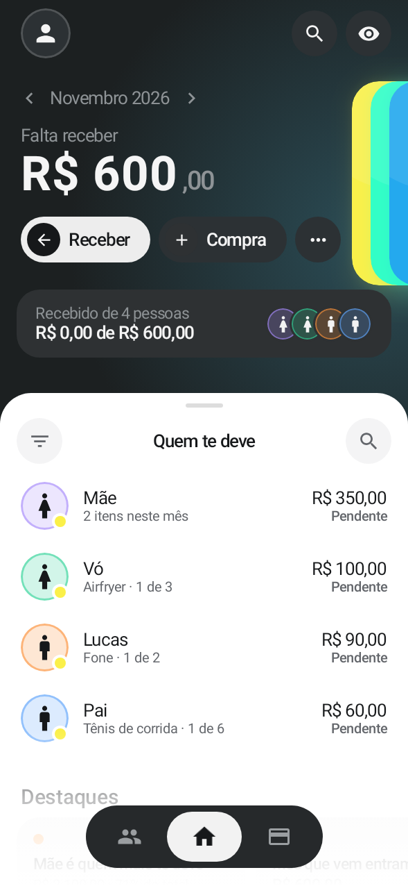<br/><sub><b>Início</b> · quanto falta receber no mês</sub></td>
    <td align="center">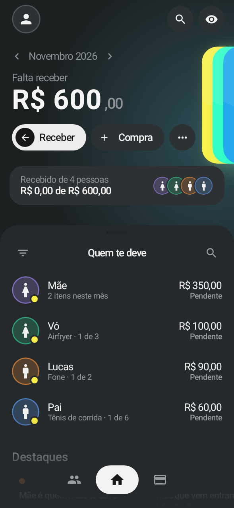<br/><sub><b>Início</b> · tema escuro</sub></td>
    <td align="center">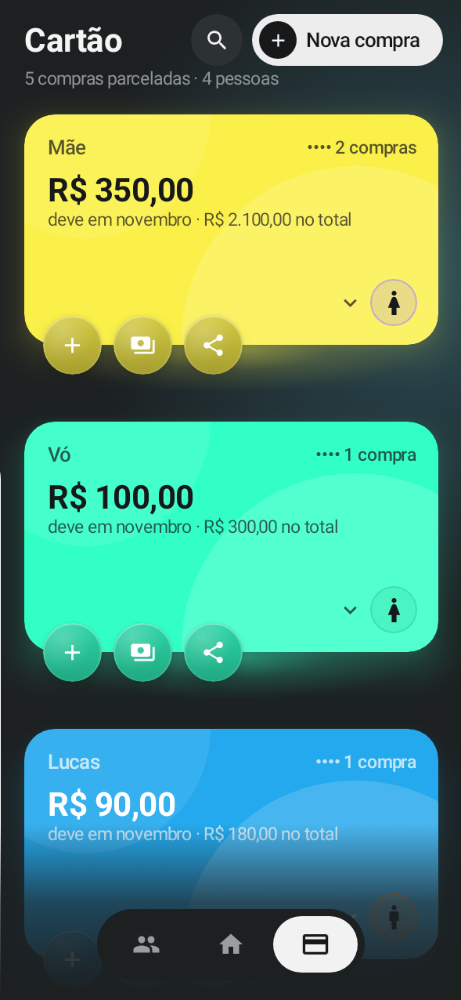<br/><sub><b>Cartão</b> · um cartão por pessoa</sub></td>
  </tr>
  <tr>
    <td align="center">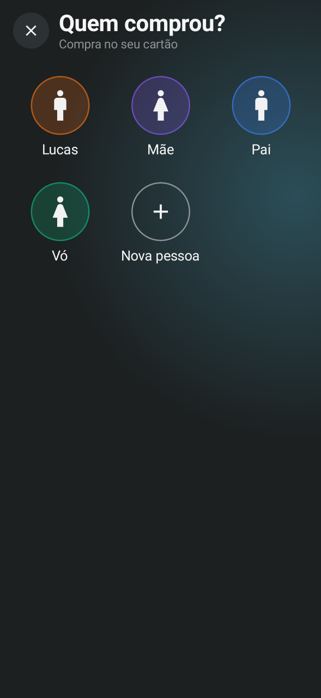<br/><sub><b>Nova compra 1/3</b> · quem comprou</sub></td>
    <td align="center">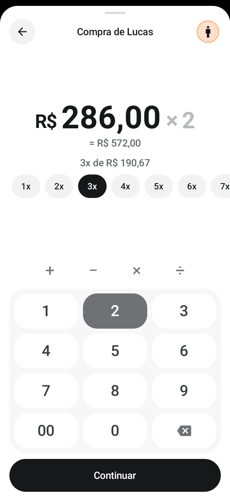<br/><sub><b>Nova compra 2/3</b> · valor, conta e parcelas</sub></td>
    <td align="center">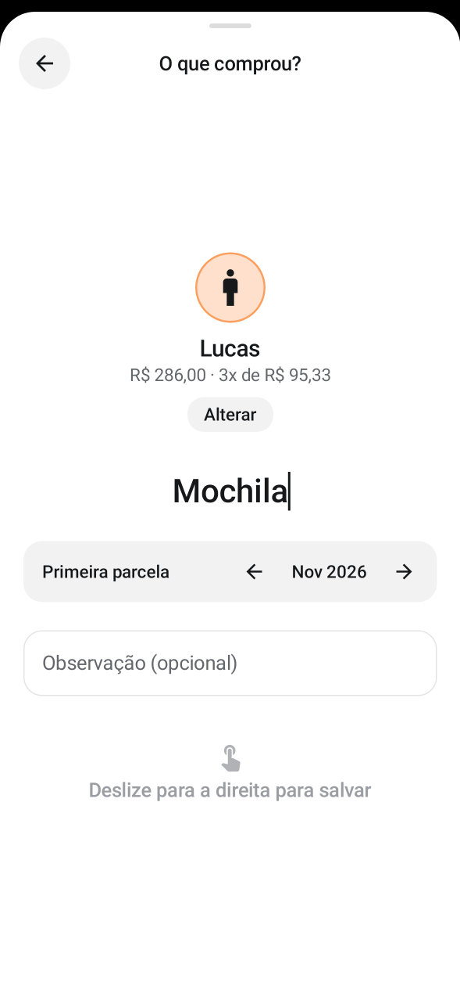<br/><sub><b>Nova compra 3/3</b> · nome e deslizar para salvar</sub></td>
  </tr>
  <tr>
    <td align="center">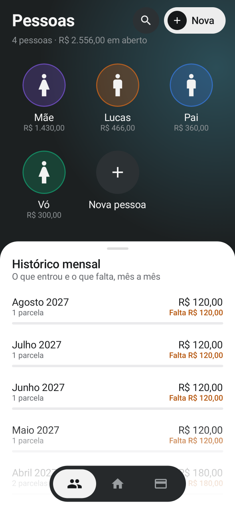<br/><sub><b>Pessoas</b> · todos e o histórico mensal</sub></td>
    <td align="center">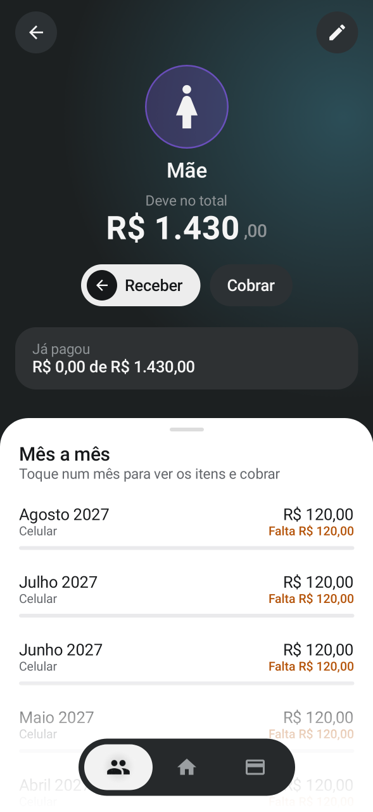<br/><sub><b>Perfil</b> · quanto deve, mês a mês</sub></td>
    <td align="center">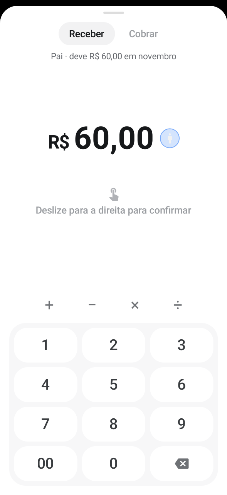<br/><sub><b>Receber</b> · teclado-calculadora</sub></td>
  </tr>
</table>

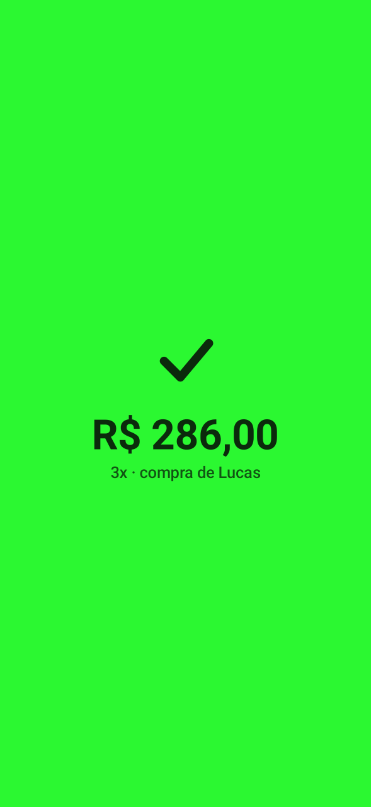
&nbsp;&nbsp;
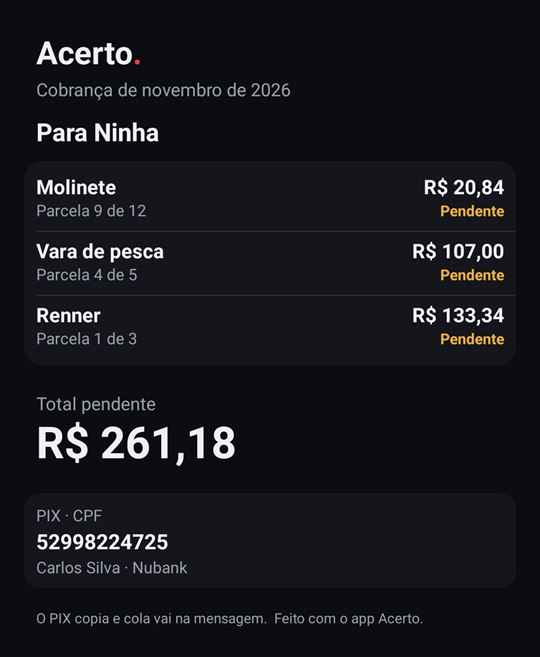<br/>
<sub><b>Sucesso</b> · fecha sozinha &nbsp;·&nbsp; <b>Cobrança</b> · imagem enviada com a mensagem (dados de exemplo)</sub>
</div>

---

## ✨ O que o Acerto faz

| | Recurso | Como funciona |
|:-:|---|---|
| 💳 | **Compras no cartão** | Em 3 etapas: quem comprou → valor e parcelas → o que foi. Na aba Cartão, cada pessoa vira um cartão colorido com quanto deve no mês, quanto falta no total, as compras dela e botões para nova compra, receber e cobrar. |
| 🧾 | **Contas divididas** | Valor → com quem (você incluído) → nome. Divisão igual ou personalizada, com aviso de quanto falta para fechar o total. Conta fixa repete por 12 meses. |
| 🔢 | **Teclado-calculadora** | Vírgula automática como nos apps de banco (1, 2, 3 → R$ 1,23), tecla `00` e contas como `143,00 × 2`. |
| 👉 | **Deslizar para confirmar** | Receber e salvar terminam com um deslize para a direita e uma tela verde que fecha sozinha. |
| 💵 | **Receber** | Escolha a pessoa, digite quanto ela pagou e o app quita as parcelas mais antigas primeiro (com pagamento parcial se sobrar). |
| 👥 | **Pessoas e perfil** | Todos numa grade, com o total em aberto de cada um. No perfil: quanto deve, quanto já pagou, mês a mês e as compras. |
| 🗓️ | **Mês inteligente** | Abre no mês mais antigo com pendência e só avança quando ele estiver todo pago. Atalho *Ir para o mês atual*. |
| ✨ | **Destaques** | Frases automáticas: quem está atrasado, quem mais deve, quanto entra no mês que vem e quanto já entrou. |
| 📈 | **Próximos meses** | Gráfico do que falta receber nos próximos 6 meses e data de quitação por pessoa. |
| 👈 | **Deslizar para pagar** | Na lista da Início, arraste a pessoa para a esquerda e o mês dela fica pago (com *Desfazer*). |
| 💸 | **Cobrança com PIX** | Imagem com as parcelas e uma mensagem curta com seu nome, banco e chave PIX (tipo detectado sozinho). |
| 📲 | **Widget e atalhos** | Widget com quanto falta receber; segure o ícone para Receber, Nova compra ou Lançar com IA. |
| 🔔 | **Lembrete** | No dia 1, ou 3 dias antes do vencimento da fatura. |
| ⚡ | **Entrada com IA** | Escreva *"Tênis de 300 em 3x para o Lucas"* e confirme. |
| 🔐 | **Bloqueio e privacidade** | Digital, rosto ou senha ao abrir; modo privacidade esconde os valores (inclusive no widget). |
| 💾 | **Backup e planilha** | Backup em JSON para restaurar e exportação em CSV para Excel e Google Planilhas. |
| 🖼️ | **Sua foto** | Foto de perfil no topo da Início; tocar nela abre os Ajustes. |

---

## 🎨 Interface

<table>
<tr>
<td width="50%" valign="top">

### 🖤 Visual

Cabeçalho escuro com um brilho azul-esverdeado, folha branca que sobe por cima com o conteúdo, cartões coloridos e pílulas arredondadas. Na Início, os cartões de quem mais deve ficam escondidos no canto direito, só com uma faixa lisa de cada cor aparecendo. A barra de baixo tem **3 abas (Pessoas, Início e Cartão)**, troca de aba **arrastando para o lado** e some ao rolar. Atrás dela o conteúdo some num fade na cor de cada tela.

Segue o **Apple HIG** (toque mínimo de 44 pt, fonte grande do sistema respeitada, contraste AA) e funciona no tema claro e no escuro.

</td>
<td width="50%" valign="top">

### 🎨 Cores

| Cor | Uso |
|---|---|
| ⬛ **Grafite** `#1C2021` | Cabeçalho e tema escuro |
| ⬜ **Branco** `#FFFFFF` | Folha de conteúdo (tema claro) |
| 🟨 **Amarelo** `#FBF049` | Cartões, pendente |
| 🟩 **Verde-água** `#32FFC6` | Cartões, pago |
| 🟦 **Azul** `#24A9EE` | Cartões, mês que vem |
| 🟢 **Limão** `#2BF831` | Tela de sucesso |

Valores pendentes em âmbar e pagos em verde, sempre com texto junto (nunca só a cor).

</td>
</tr>
</table>

### 🎬 Movimento

Molas e curvas inspiradas no [transitions.dev](https://transitions.dev): entrar em 250 ms, sair em 150 ms, curva *smooth-out*.

<div align="center">
<table>
  <tr>
    <td align="center"><br/><sub><b>1.</b> Cartões lisos no canto</sub></td>
    <td align="center">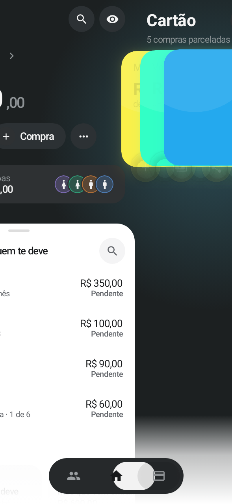<br/><sub><b>2.</b> Atravessam juntos com o dedo</sub></td>
    <td align="center">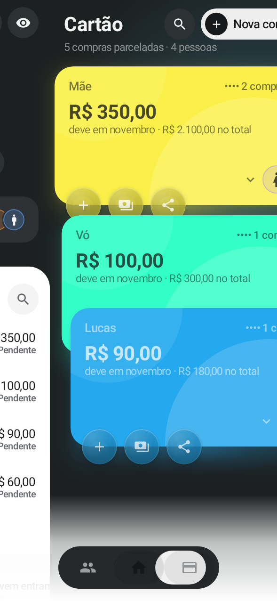<br/><sub><b>3.</b> Abrem um depois do outro</sub></td>
    <td align="center"><br/><sub><b>4.</b> Viram a lista do Cartão</sub></td>
  </tr>
</table>
</div>

- 🃏 Da Início para o Cartão, os 3 cartões em destaque saem do canto e atravessam a tela juntos, acompanhando o dedo (ou a mola, ao tocar na barra). O conteúdo aparece no caminho e, no fim, eles abrem em lista um depois do outro, 40 ms de diferença. Soltou antes da metade? Eles voltam para o canto.
- 👥 Indo para Pessoas, as fotos saem juntas da Início e se espalham pela grade
- 📄 Folha branca que sobe com mola e o fundo que recua e escurece
- ➡️ Etapas que deslizam para o lado, na direção do avanço
- ⌨️ Pílula escura que segue o dedo de tecla em tecla
- 🃏 Cartões e pessoas que entram em cascata
- ✅ Check que se desenha na tela verde, que some sozinha
- 🔢 Dígitos do valor que entram um a um
- ♿ Movimento reduzido do sistema respeitado

---

## 🚀 Instalação

1. Abra a página de [**Releases**](https://github.com/carlos-gds/acerto/releases/latest) e baixe o `Acerto-vX.Y.apk` mais recente (cerca de 3 MB).
2. Abra o arquivo no celular e permita *instalar apps de fontes desconhecidas*, se o Android pedir.
3. Pronto: requer **Android 7.0** ou superior. Novas versões instalam por cima e mantêm seus dados.

> [!IMPORTANT]
> **Vindo da versão 1.3.4 ou anterior?** A chave de assinatura mudou na 1.4, então o Android não instala por cima. Antes, faça um backup em **Ajustes → Backup**, anote sua chave PIX, desinstale a versão antiga, instale a nova e restaure o backup. Da 1.4 em diante, uma versão atualiza a outra normalmente.

---

## 🛠️ Para desenvolvedores

<details>
<summary><b>Tecnologias</b></summary>

<br/>

- **Kotlin** + **Jetpack Compose** + **Material 3**
- **Room** com migrations versionadas e esquema exportado em `app/schemas`
- **Coroutines** e **Flow**, **MVVM** com Repository pattern
- **Release otimizada:** R8, recursos enxutos e baseline profiles das bibliotecas
- Recursos nativos, sem bibliotecas extras: notificações e `AlarmManager` (lembrete), `BiometricPrompt` (bloqueio), `FileProvider` (imagem de cobrança), Canvas (desenho da imagem), `AppWidgetProvider` (widget) e atalhos estáticos
- **Gemini API** (via OkHttp) para a entrada rápida, opcional
- **Gradle Wrapper** e Version Catalog
- **JUnit**, **Robolectric**, **Compose UI Test** e **Roborazzi**

</details>

<details>
<summary><b>Estrutura do projeto</b></summary>

```text
app/src/main/java/com/example/
├── data/
│   ├── backup/       # Modelos, serialização, validação e restauração
│   ├── db/           # Room Database, DAOs e migrations
│   ├── model/        # Entidades e modelos de domínio
│   ├── repository/   # Regras de acesso e operações financeiras
│   └── service/      # Integrações externas (Gemini)
├── ui/
│   ├── components/   # Cards, diálogos, barra inferior, controles, avatares
│   │   └── glass/    # Superfícies, movimento e transições
│   ├── screens/      # Início, Pessoas e perfil, Cartão, fluxos em etapas, Receber, Ajustes
│   ├── theme/        # Cores, tokens, tipografia e medidas
│   └── viewmodel/    # Estado da interface e ações
└── util/             # Dinheiro, calculadora, PIX, previsão, destaques, CSV, widget, lembrete, bloqueio
```

Os valores ficam no banco em **centavos (`Long`)**. A conversão para reais acontece só na tela, o que evita erros de arredondamento. O pagamento parcial divide a parcela em duas linhas (parte paga e restante), sem mudar o esquema do banco.

| Versão do banco | Mudança |
|:-:|---|
| 1 | Esquema inicial (valores em `REAL`) |
| 2 | Valores convertidos para centavos (`INTEGER`) |
| 3 | Coluna `avatar` em `people` (padrão `NEUTRAL`) |

</details>

<details>
<summary><b>Compilar e testar</b></summary>

<br/>

Pré-requisitos: Android Studio Ladybug ou posterior, JDK 17+ (o do Android Studio serve) e Android SDK com API 36.

```bash
./gradlew :app:assembleRelease
./gradlew :app:testDebugUnitTest
```

O APK otimizado sai em `app/build/outputs/apk/release/`. No Windows, use `gradlew.bat` no lugar de `./gradlew`.

A release usa a chave de upload apontada por `KEYSTORE_PATH` (ou `my-upload-key.jks` na raiz) quando ela existe; sem ela, assina com a chave de debug da máquina.

</details>

<details>
<summary><b>Chave da API Gemini (opcional)</b></summary>

<br/>

Sem chave, a entrada rápida usa um leitor local, mais simples. Para usar a IA:

1. Copie `.env.example` para `.env`.
2. Preencha `GEMINI_API_KEY=sua_chave_aqui`.

O `.env` está no `.gitignore`. A chave é enviada no cabeçalho `x-goog-api-key`, nunca na URL.

> [!WARNING]
> A chave fica embutida no APK. Use uma chave restrita ao app no Google Cloud ou migre para o Firebase AI Logic antes de distribuir publicamente.

</details>

---

## 🔒 Privacidade

- 📵 Sem login, sem nuvem: **todos os dados ficam no seu aparelho**.
- 🔐 Bloqueio opcional com a digital, o rosto ou a senha do celular.
- 🙈 Modo privacidade para usar o app em público.
- 💳 Chave PIX, nome e banco ficam só no aparelho, fora do backup.
- 🗂️ Backups são arquivos JSON que só você controla.
- 🧱 Gravações de vários passos rodam em transação (tudo ou nada).
- 📜 Detalhes em [PRIVACY.md](PRIVACY.md).

---

## 🗺️ Próximos passos

- [x] ↩️ Desfazer exclusão de lançamentos
- [x] 🔔 Lembrete mensal e antes do vencimento da fatura
- [x] 🖼️ Cobrança como imagem, com nome, banco e tipo da chave PIX
- [x] 📈 Previsão dos próximos meses e data de quitação por pessoa
- [x] ➗ Pagamento parcial de parcelas
- [x] 🔐 Bloqueio do app com biometria ou senha
- [x] ♿ Layout que se adapta à fonte grande do sistema
- [x] 🚀 Versão otimizada (APK de 3 MB, bem mais fluido)
- [x] 🖤 Visual novo: cabeçalho escuro, cartões empilhados e teclado de receber
- [x] 📲 Widget, atalhos no ícone, destaques e deslizar para marcar pago
- [x] 📄 Exportar planilha CSV
- [x] 🪜 Nova compra e Dividir conta em etapas, com teclado-calculadora
- [x] 👥 Pessoas com perfil e histórico; Cartão separado por pessoa
- [x] 👉 Trocar de aba arrastando e deslizar para confirmar
- [x] 🃏 Cartões que atravessam da Início para o Cartão e abrem em sequência
- [ ] 🤖 Entrada com IA via Firebase AI (sem chave no APK)
- [ ] 🔑 Chave de assinatura própria para distribuição
- [ ] ✏️ Editar lançamentos também em etapas

---

<div align="center">

<sub>Antigo <b>Quem Me Deve</b> · backups com o nome antigo continuam funcionando</sub>

<sub>Licença ainda não definida: até lá, todos os direitos reservados.</sub>

</div>
